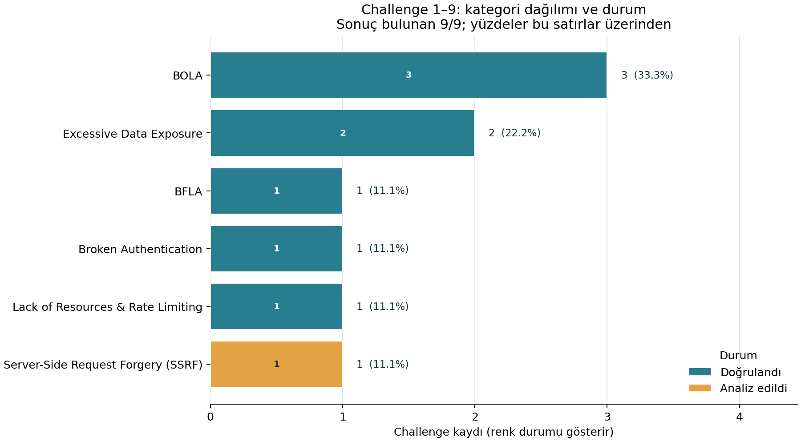
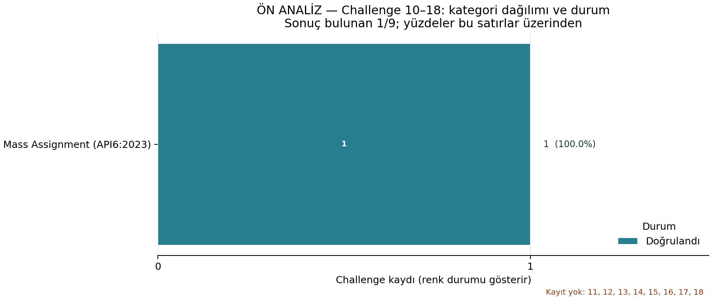

# Challenge testlerinin istatistiksel özeti

## Genel kapsam

- Planlanan Challenge numarası: 18
- CSV'de kayıtlı benzersiz Challenge: 10 (55.6% kapsam)
- Beklemede olmayan sonuç kaydı: 10; beklemede: 0; kaydı yok: 8
- Durum sayıları: doğrulandı 9, analiz edildi 1, diğer nihai sonuç 0
- Kayıtlı sonuçlar içindeki doğrulanmış payı: 90.0% (9/10)
- Nihai sonuçlar içindeki doğrulama oranı: 100.0% (9/9)
- Kaydı bulunmayan numaralar: 11, 12, 13, 14, 15, 16, 17, 18

## Yöntem

- Kaynak: `findings/challenges.csv`. Postman koleksiyonu istek ve test betiklerini içerir; çalıştırma sonuçlarının dışa aktarımı değildir.
- Analiz birimi benzersiz `challenge_no` içeren CSV satırıdır; kanıt dosyaları veya yinelenen ekran görüntüleri ayrı bulgu olarak sayılmaz. Her challenge tek ana kategoriye sayılır.
- Kategori paydası ilgili aralıktaki beklemede olmayan, CSV'de kayıtlı sonuç satırlarıdır. `analiz_edildi` kategori sayımına girer ve grafikte doğrulanmış bulgulardan ayrı renkle gösterilir.
- Doğrulanmış pay = `doğrulandı` ÷ beklemede olmayan kayıtlı sonuç satırları. Doğrulama oranı = `doğrulandı` ÷ nihai durumu olan testler (`doğrulandı` + nihai olumsuz sonuç). Analiz edilen, bekleyen ve kaydı olmayan satırlar bu oranın paydasına girmez.
- Kayıt kapsamı, planlanan challenge numaralarına göre hesaplanır. Eksik kayıtlar tamamlanmış veya başarısız sayılmaz; aralık raporlarında ayrıca listelenir.
- Kategori yoğunluğu, test kayıtlarının dağılımını gösterir; tek başına zafiyet önemini veya risk seviyesini göstermez.
- CSV güncellendikten sonra rapor ve grafikler depo kökünden `python findings/analyze_challenges.py` komutuyla yeniden üretilir.

## Challenge 1–9

- Planlanan Challenge numarası: 9
- CSV'de kayıtlı Challenge satırı: 9 (100.0% kapsam)
- Beklemede olmayan sonuç satırı: 9 (100.0% kapsam)
- Beklemede olan Challenge numaraları: yok
- CSV'de kaydı bulunmayan numaralar: yok
- Duruma göre: doğrulandı 8, analiz edildi 1, diğer nihai sonuç 0
- Sonuç satırları içindeki doğrulanmış payı: 88.9% (8/9)
- Nihai sonuçlar içindeki doğrulama oranı: 100.0% (8/8)
- Durum sayıları: `analiz_edildi`: 1, `doğrulandı`: 8

| Kategori | Sonuç kaydı | Pay | Doğrulandı | Analiz edildi | Diğer nihai sonuç |
|---|---:|---:|---:|---:|---:|
| BOLA | 3 | 33.3% | 3 | 0 | 0 |
| Excessive Data Exposure | 2 | 22.2% | 2 | 0 | 0 |
| BFLA | 1 | 11.1% | 1 | 0 | 0 |
| Broken Authentication | 1 | 11.1% | 1 | 0 | 0 |
| Lack of Resources & Rate Limiting | 1 | 11.1% | 1 | 0 | 0 |
| Server-Side Request Forgery (SSRF) | 1 | 11.1% | 0 | 1 | 0 |

- En sık görülen kategori: BOLA (3/9, 33.3%).

## Challenge 10–18 — ÖN ANALİZ (EKSİK/BEKLEYEN TEST)

- Planlanan Challenge numarası: 9
- CSV'de kayıtlı Challenge satırı: 1 (11.1% kapsam)
- Beklemede olmayan sonuç satırı: 1 (11.1% kapsam)
- Beklemede olan Challenge numaraları: yok
- CSV'de kaydı bulunmayan numaralar: 11, 12, 13, 14, 15, 16, 17, 18
- Duruma göre: doğrulandı 1, analiz edildi 0, diğer nihai sonuç 0
- Sonuç satırları içindeki doğrulanmış payı: 100.0% (1/1)
- Nihai sonuçlar içindeki doğrulama oranı: 100.0% (1/1)
- Durum sayıları: `doğrulandı`: 1

| Kategori | Sonuç kaydı | Pay | Doğrulandı | Analiz edildi | Diğer nihai sonuç |
|---|---:|---:|---:|---:|---:|
| Mass Assignment (API6:2023) | 1 | 100.0% | 1 | 0 | 0 |

- En sık görülen kategori: Mass Assignment (API6:2023) (1/1, 100.0%).

> Bu grafik ön analizdir. Kategori paydası yalnızca beklemede olmayan kayıtlı sonuç satırlarıdır. Bekleyen veya kaydı olmayan Challenge'lar başarılı, başarısız ya da doğrulanmış sayılmamıştır.
